<p align="center">
  
</p>

<h1 align="center">Caderno</h1>

<p align="center">App de notas (React Native + Expo, foco Android) implementado a partir do design <code>Caderno.dc.html</code>.</p>

## Telas

| Notas | Filtro por tag | Busca |
| :---: | :---: | :---: |
| 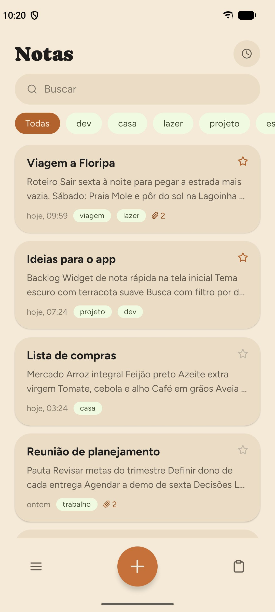 | 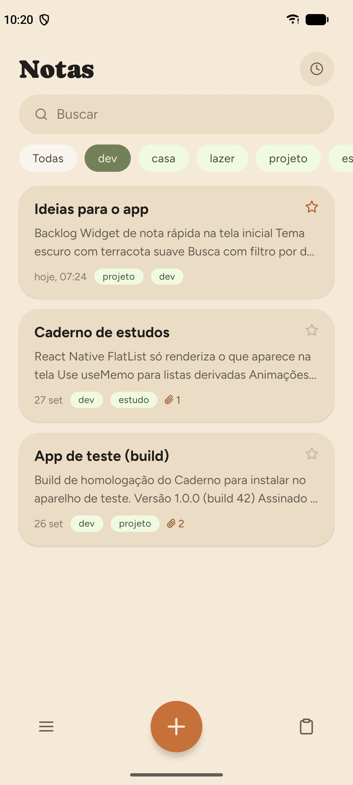 | 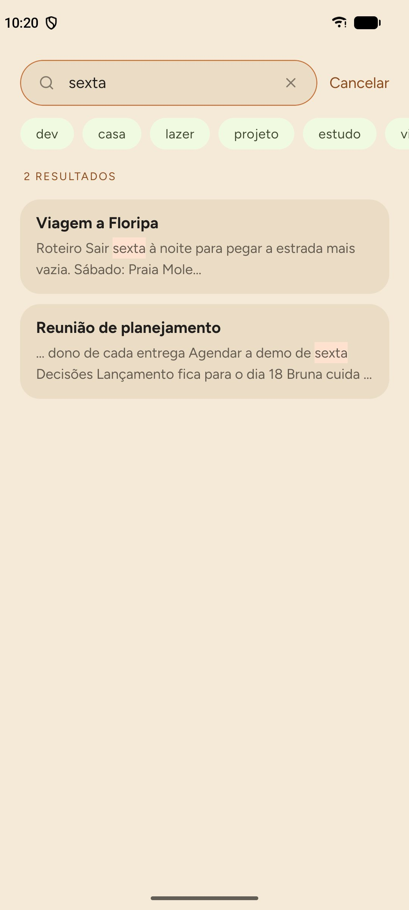 |

| Editor | Edição markdown | Opções da nota |
| :---: | :---: | :---: |
| 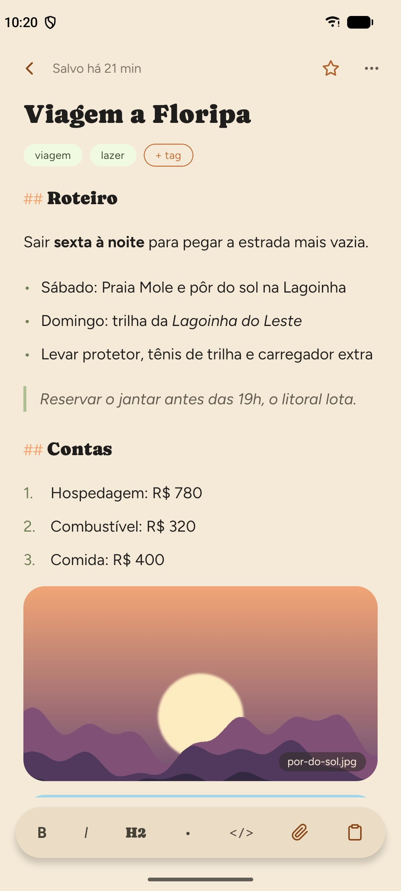 | 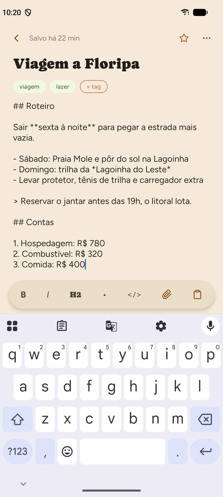 | 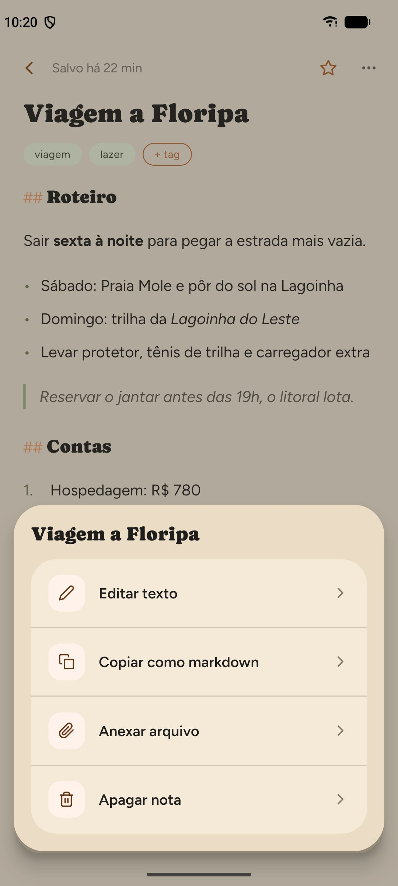 |

| Anexos de imagem | Anexos de arquivo | PDF e planilha |
| :---: | :---: | :---: |
| 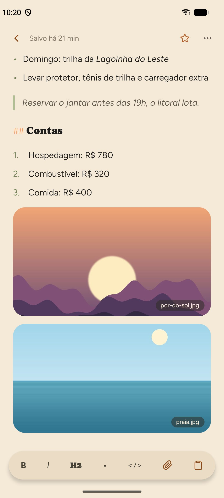 | 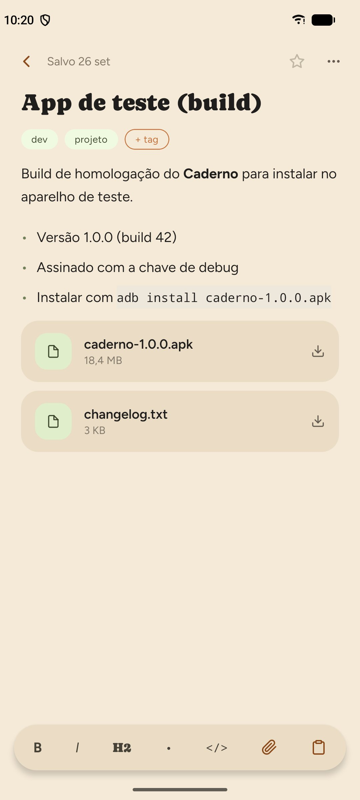 | 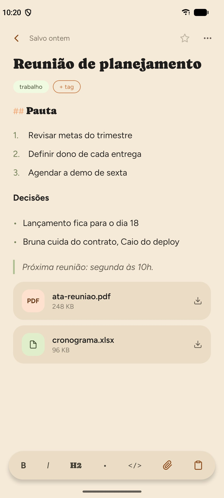 |

| Receita | Nova tag | Favoritas |
| :---: | :---: | :---: |
| 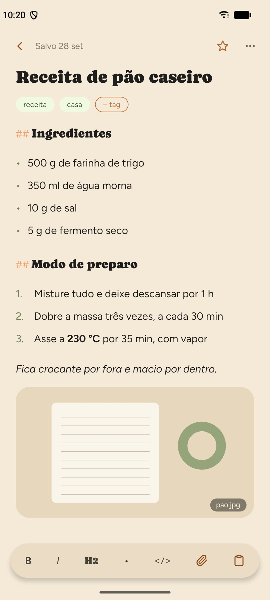 | 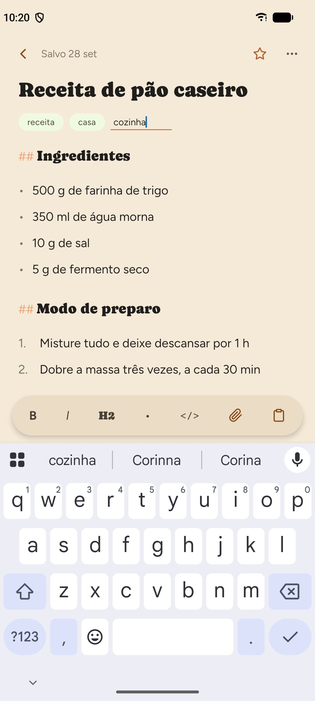 | 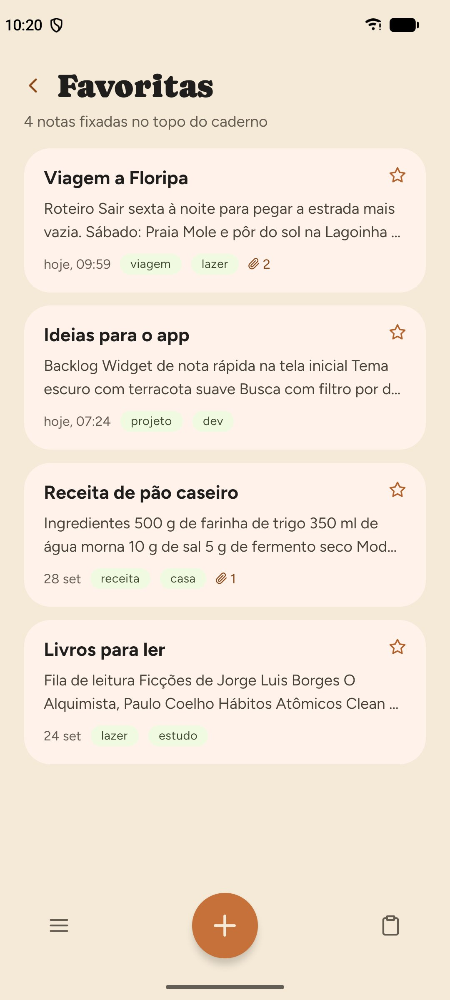 |

| Menu | Área de transferência | Backup e exportação |
| :---: | :---: | :---: |
| 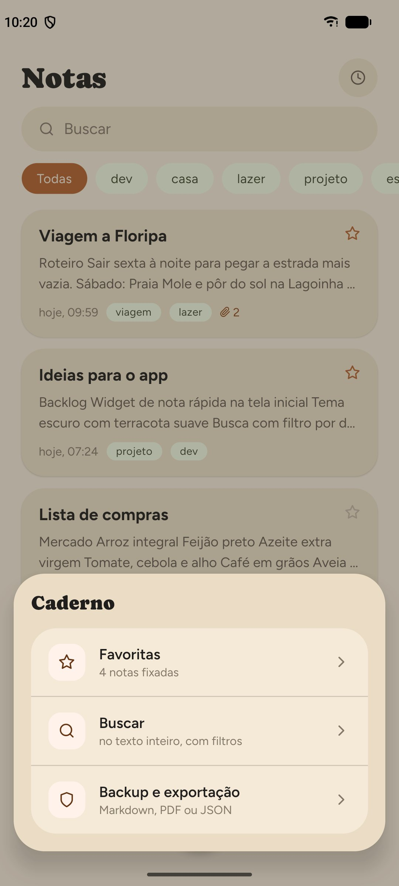 | 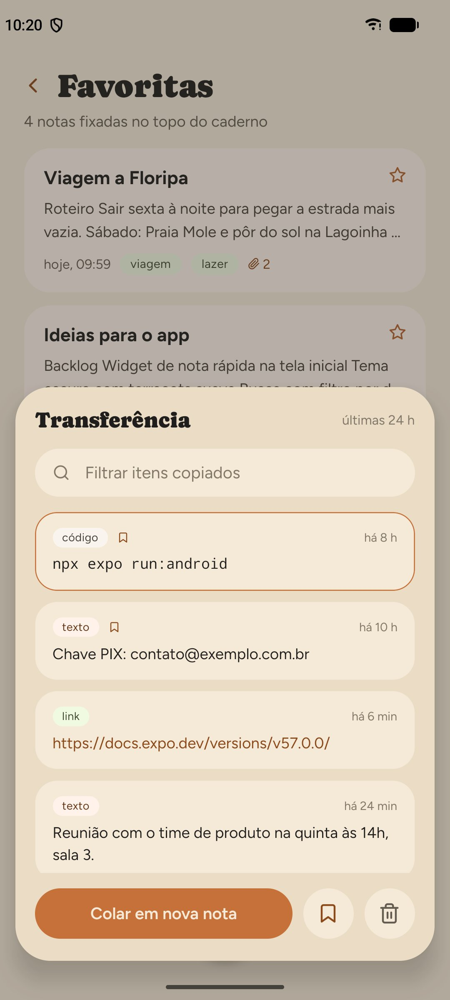 | 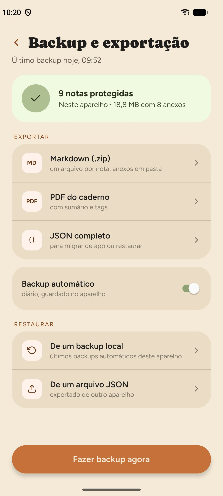 |

## Funcionalidades

- Lista de notas com chips de tag, ordenação e busca
- Editor markdown (formatado ao tocar fora; toolbar B / I / H2 / lista / código)
- Tags, favoritas (tela em terracota), anexos (imagens e arquivos copiados para o app)
- Autosave, backup automático local diário, exportação Markdown (.zip), PDF e JSON, restauração
- Overlay de área de transferência: histórico tipado (texto / link / código), filtro, fixar, apagar, colar na nota

## Rodar

```bash
npm install
npx expo start --android
```

Precisa de Expo Go no aparelho/emulador, ou `npx expo run:android` para build nativo (Android SDK instalado).

## Estrutura

- `src/theme.ts` — tokens do design system Organic
- `src/store/` — notas/configurações e área de transferência (AsyncStorage)
- `src/lib/` — markdown, datas, arquivos, backup/exportação
- `src/screens/` — Notas, Editor, Busca, Favoritas, Backup
- `src/components/` — cards, chips, nav inferior, sheets
